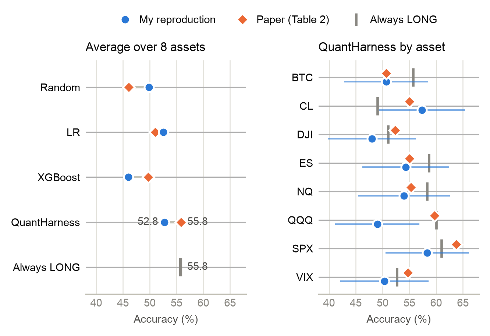
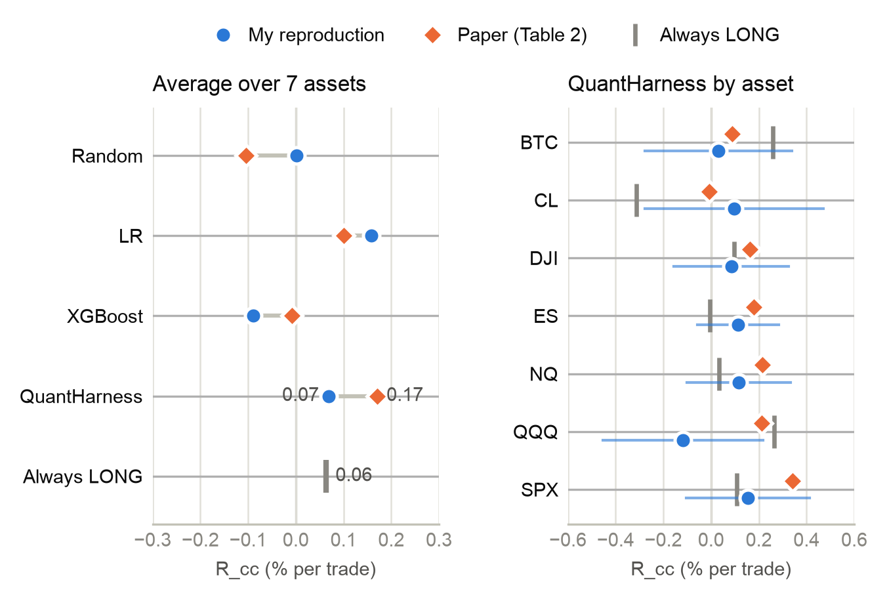

# QuantHarness — Reproduction & Experimental Analysis

This repository contains a review of the paper [QuantHarness: Price-Driven Multi-Agent LLMs for High-Frequency Trading (Xiong et al., 2025)](https://arxiv.org/abs/2509.09995v4) with a reproduction and experimental analysis.

[Original implementation](https://github.com/Y-Research-SBU/QuantHarness); [original README](ORIGINAL_README.md).

This project builds upon the original implementation by Y-Research @SBU, licensed under the MIT License.
The original license and copyright notice are preserved in the [LICENSE](LICENSE) file.

## Presentation

The presentation of the paper review is available [here](reproduction/presentation/main.pdf).

## Reproduction

The libraries required for running the reproduction are listed in [reproduction-requirements.txt](reproduction-requirements.txt) and need Python 3.11 or newer. To install all libraries necessary for both the original code and my experiment, run:

```bash
pip install -r reproduction-requirements.txt
```

The experiment can be rerun in [this notebook](reproduction/experiment/experiment.ipynb).

Since baseline models are not provided by the authors, I implemented them from scratch using the information given in the paper. There are a few things to note:

1. For this reproduction I used the historical data from the paper (located [here](benchmark)), using the last 3 candles for evaluation. The original implementation (from the GitHub repo) is meant for real-time use, so it feeds the last 45 candles to the agents, which in my case would lead to leakage. Hence, I adapted the code instead of completely reusing the functions from [web_interface.py](web_interface.py).

2. The paper says that 97 candles were used as the model's input and the last 3 for evaluation. It is not stated whether all 97 are used or a smaller window is applied. In the paper's repo the 45-candle window is used, so I decided to stick to the repository's version and used the 45 latest candles for model reasoning and the last 3 for evaluation.

3. For the Random approach I averaged the results across 100 seeds for fairness. The paper's Random result is close to my worst seed's 8-asset average, so it is unusually low: below 99 of the 100 seeds.

4. For XGBoost I used a chronological split instead of the random split (which is used in the paper) to avoid data leakage between the train and test sets. The "leaked" version performed significantly "better".

5. Linear Regression fits the last 40 closes as the paper describes.

6. In my implementation QuantHarness ran on Gemini 3.5 / 3.1 Flash-Lite for 98.5% of segments. The repo's default model is OpenAI's gpt-4o, though it's not stated which exact model was used in the paper's experiment.

7. Returns ($R_{cc}$, $R_{max}$, $R_{min}$) are computed without stop-loss or take-profit caps. The [latest version](https://arxiv.org/abs/2509.09995v4) of the paper says each trade exits at a 0.05% stop-loss or at an $r$ × 0.05% take-profit, where $r$ is the risk-reward ratio between 1.2 and 1.8. That would keep every return between -0.05% and +0.09%. Yet Table 2 reports values such as 1.220% and -1.245% (BTC, Random), which match the uncapped formulas from the [earlier version](https://arxiv.org/abs/2509.09995v2) of the paper, so I used those. The repo does not implement a stop-loss or take-profit anywhere either.

8. The 1h QQQ and SPX runs are not finished yet: 97/100 QQQ and 54/100 SPX segments have been evaluated so far.

### Main results

The obtained results are the following:



**4h directional accuracy (%)**: this reproduction, with the paper's Table 2 in brackets

| Asset | Random | LR | XGBoost | QuantHarness | Always LONG |
|---|---|---|---|---|---|
| BTC | 50.2 (45.0) | 45.0 (46.0) | 60.0 (45.3) | 50.7 (50.7) | 55.7 |
| CL | 50.3 (41.0) | 56.3 (54.3) | 50.0 (40.0) | 57.3 (55.0) | 49.0 |
| DJI | 50.0 (47.0) | 53.0 (52.0) | 47.3 (47.3) | 48.0 (52.3) | 51.0 |
| ES | 50.3 (51.0) | 48.7 (43.0) | 32.7 (52.0) | 54.3 (55.0) | 58.7 |
| NQ | 49.3 (43.7) | 47.7 (48.7) | 38.0 (47.3) | 54.0 (55.3) | 58.3 |
| QQQ | 49.9 (47.3) | 60.7 (56.0) | 39.3 (52.7) | 49.0 (59.7) | 60.0 |
| SPX | 50.0 (47.3) | 59.0 (59.7) | 46.7 (60.0) | 58.3 (63.7) | 61.0 |
| VIX | 49.0 (46.3) | 49.7 (48.7) | 54.0 (53.3) | 50.3 (54.7) | 52.7 |
| **Mean** | **49.9** (46.1) | **52.5** (51.1) | **46.0** (49.7) | **52.8** (55.8) | **55.8** |

**1h directional accuracy (%)**: this reproduction only, since the paper shows its 1h results as a chart (Fig. 5)

| Asset | Random | LR | XGBoost | QuantHarness | Always LONG |
|---|---|---|---|---|---|
| BTC | 50.4 | 49.3 | 43.3 | 46.0 | 50.0 |
| CL | 49.5 | 43.7 | 52.0 | 49.0 | 46.3 |
| DAX | 49.8 | 49.0 | 48.7 | 54.3 | 50.7 |
| DJI | 49.2 | 52.7 | 48.7 | 56.0 | 54.3 |
| ES | 49.5 | 54.3 | 44.7 | 51.7 | 53.0 |
| NQ | 49.4 | 55.0 | 55.3 | 56.7 | 52.3 |
| QQQ | 50.7 | 53.3 | 45.3 | 51.5\* | 55.0 |
| SPX | 50.3 | 54.0 | 51.3 | 51.2\* | 54.3 |
| **Mean** | **49.8** | **51.4** | **48.7** | **52.1** | **52.0** |

\* Still running: 97/100 QQQ and 54/100 SPX segments so far.
 
Always LONG goes LONG on every segment. It is not in the paper, but it is the score a method has to beat to show any timing skill.

QuantHarness's 4h accuracy is within sampling noise of the paper's on 7 of 8 assets (joint p = 0.65). It does not beat LR on the same segments (+0.3 points, standard error 1.8), and it is below Always LONG.

### Returns



**4h returns (% per trade), mean over 7 assets with VIX left out**: this reproduction, with the paper's Table 2 in brackets

| Method | $R_{cc}$ | $R_{max}$ | $R_{min}$ |
|---|---|---|---|
| Random | 0.00 (-0.10) | 0.90 (0.83) | -0.90 (-0.94) |
| LR | 0.16 (0.10) | 1.00 (0.95) | -0.80 (-0.83) |
| XGBoost | -0.09 (-0.01) | 0.97 (0.88) | -0.99 (-0.89) |
| QuantHarness | 0.07 (0.17) | 0.94 (0.97) | -0.86 (-0.80) |
| Always LONG | 0.06 | 0.90 | -0.90 |

**4h $R_{cc}$ (% per trade) by asset**: this reproduction, with the paper's Table 2 in brackets

| Asset | Random | LR | XGBoost | QuantHarness | Always LONG |
|---|---|---|---|---|---|
| BTC | 0.01 (-0.01) | -0.06 (-0.07) | 0.38 (-0.05) | 0.03 (0.09) | 0.26 |
| CL | 0.02 (-0.37) | 0.12 (-0.11) | -0.19 (-0.06) | 0.10 (-0.01) | -0.31 |
| DJI | 0.00 (0.05) | 0.16 (0.15) | -0.11 (-0.02) | 0.08 (0.16) | 0.10 |
| ES | 0.00 (-0.05) | 0.14 (0.03) | -0.12 (-0.18) | 0.11 (0.18) | -0.01 |
| NQ | -0.02 (-0.14) | 0.10 (0.15) | -0.31 (-0.01) | 0.12 (0.22) | 0.03 |
| QQQ | -0.01 (-0.05) | 0.30 (0.18) | -0.14 (0.21) | -0.12 (0.21) | 0.26 |
| SPX | 0.00 (-0.16) | 0.36 (0.38) | -0.13 (0.05) | 0.15 (0.34) | 0.11 |
| VIX† | -0.09 (0.06) | 1.26 (-0.14) | -1.92 (0.16) | 1.68 (0.46) | 2.10 |

† Not comparable: in the repo's data, VIX price ranges ($R_{max}$ - $R_{min}$) are about 1.8 times the paper's for every method, so its returns are on a different scale and are left out of the means.

- All returns are uncapped and measured from the last visible close over the next 3 candles: $R_{cc}$ to the third close, $R_{max}$ to the best high (LONG) or low (SHORT), $R_{min}$ to the worst.
- On the same segments, $R_{max} - R_{min}$ is the full price range, so it is the same for every method. $R_{max}$ and $R_{min}$ therefore mostly reflect volatility and rank methods the same way. XGBoost's values come from its 50 test files, which is another reason they differ.

QuantHarness earns 0.07% per trade against the paper's 0.17%. On the same segments it is level with Always LONG (+0.01 points, standard error 0.08) and below LR (-0.09, standard error 0.07). The paper reports the best $R_{cc}$ on 7 of 8 assets; in my experiment QuantHarness is best on 1 of 7 (NQ).

## Suggested improvements

The main limitation of QuantHarness is the insufficient justification for using LLMs in price-based trading. In text-based approaches the use of LLMs makes sense, whereas when the only input is numerical price data, there are cheaper and simpler methods, which the paper's approach does not seem to significantly outperform.

I suppose LLMs might be useful for researching, designing, or explaining trading strategies without necessarily being useful for making individual trading decisions. For example, an LLM could help formulate hypotheses, generate backtesting code, interpret diagnostic results, etc.

In short, interpreting RSI, MACD, and candlestick shapes every hour may be an unnecessarily expensive and unreliable way to implement what could ultimately be a simple numerical decision rule.
